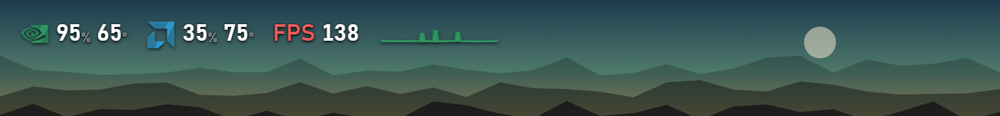
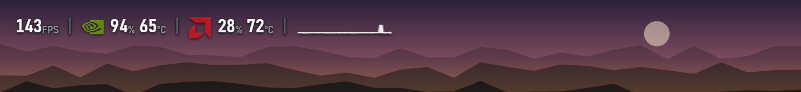
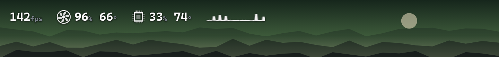
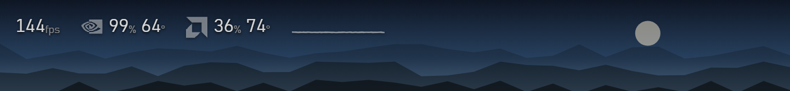
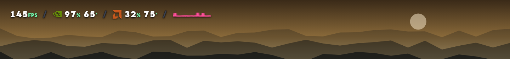
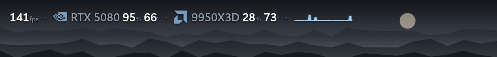
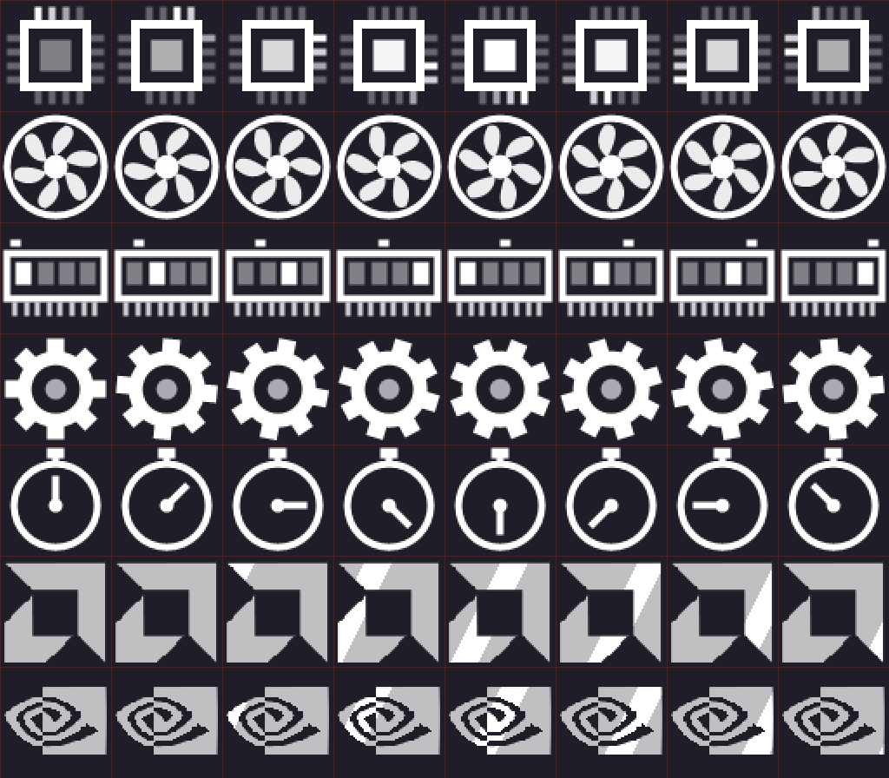
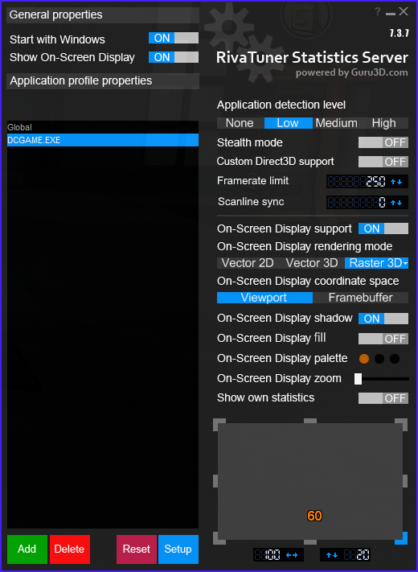
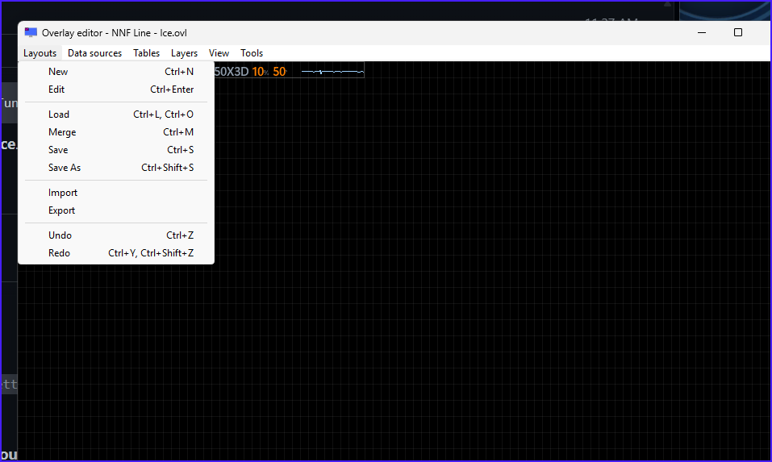
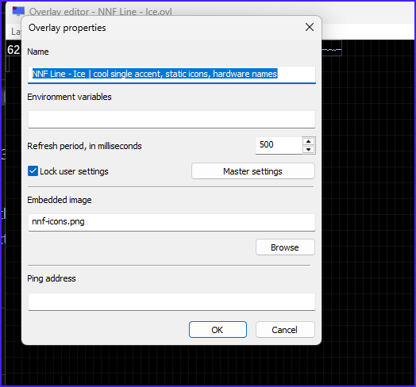

<div align="center">

# RivaTuner Statistics Server minimal overlay skins

**Six one-line overlays for RivaTuner Statistics Server: FPS, GPU and CPU load and temperature, and a frametime graph, with animated AMD and NVIDIA icons.**
<br />
No background box and no extra software. Copy two files, load the one you like, and play.

<br />

[](https://github.com/nnfisfree/rtss-minimal-skins/releases/latest)


<br />



<sub>Previews use simulated values on a painted backdrop. In game it looks the same, on top of your game.</sub>

</div>

---

## What is this?

[RivaTuner Statistics Server](https://www.guru3d.com/download/rtss-rivatuner-statistics-server-download/) (RTSS) draws the on-screen display you see in games: FPS, temperatures, frametimes. Its **OverlayEditor** plugin can load *layouts* (`.ovl` files) that decide what that display looks like.

**Line** is a set of six such layouts. Each one is a single thin row in the top-left corner:

- **FPS**
- **GPU** usage and temperature
- **CPU** usage and temperature
- a small **frametime graph**, so you can spot stutters

The GPU and CPU are marked with small AMD or NVIDIA logos, a chip or a fan. They come from one image, `line-icons.png`, and gently animate in five of the six skins. All values come from RTSS's own hardware readings, so **you don't need MSI Afterburner, HWiNFO or anything else.**

## The skins

| | Skin | Look | Font |
|---|---|---|---|
|  | **Classic** | GPU and CPU first, green and blue logos, red FPS label | Bahnschrift |
|  | **Brand** | NVIDIA green and AMD red logos, `°C`, thin dividers | Bahnschrift SemiCondensed |
|  | **Monospace** | Monospace, all white, chip and fan icons instead of brand logos | Cascadia Mono |
|  | **Minimal** | Light, translucent text and icons that stay out of the way | Bahnschrift Light |
|  | **Bold** | Heavy all-caps, green, orange and pink accents | LEMON MILK* |
|  | **Frost** | One cool blue accent, still icons, shows your GPU and CPU names, resizable with the RTSS zoom slider | Segoe UI Variable |

<sub>*LEMON MILK is a free font that isn't part of Windows; see [Fonts](#fonts).</sub>

### The icon sheet

All skins share `line-icons.png`: seven rows of eight 64×64 frames, drawn white so each skin can tint them any color. The animated skins loop through a row's eight frames; Frost shows only the first.

<div align="center">

</div>

---

## Install

### 1. Get RTSS

Install [RivaTuner Statistics Server](https://www.guru3d.com/download/rtss-rivatuner-statistics-server-download/) 7.3 or newer, if you don't have it already. It also comes bundled with MSI Afterburner; either one works.

### 2. Download the skins

Open the **[latest release](https://github.com/nnfisfree/rtss-minimal-skins/releases/latest)**, download `rtss-minimal-skins-v….zip` under *Assets*, and extract it anywhere. Inside you'll find an `INSTALL.txt` with these same steps, plus:

```
Line - Bold.ovl
Line - Brand.ovl
Line - Classic.ovl
Line - Frost.ovl
Line - Minimal.ovl
Line - Monospace.ovl
line-icons.png           ← required, the skins load their icons from it
```

### 3. Copy them into the RTSS overlays folder

Copy the `.ovl` files **and `line-icons.png`** into:

```
C:\Program Files (x86)\RivaTuner Statistics Server\Plugins\Client\Overlays
```

Windows will ask for administrator permission because it's inside *Program Files*. Click **Continue**.

> [!IMPORTANT]
> `line-icons.png` must sit **in the same folder** as the `.ovl` files. If it's missing, the numbers still show but every icon is blank.

> [!TIP]
> Installed RTSS somewhere else? Open RTSS, click **Setup**, and look at the path in the window title, or right-click the RTSS shortcut → *Open file location*. The `Plugins\Client\Overlays` folder is inside it.

### 4. Turn on the OverlayEditor plugin

1. Open RTSS from the tray icon.
2. Make sure **On-Screen Display support** is **ON**.
3. Click **Setup** (bottom right) and open the **Plugins** tab.
4. Tick **`OverlayEditor.dll`**, then select it and click **Setup** (or double-click it). The Overlay editor opens.

<div align="center">

</div>

### 5. Load a skin

In the Overlay editor, open **Layouts → Load** (`Ctrl+L`) and pick one of the `Line - … .ovl` files. Its preview appears at the top of the editor.

<div align="center">

</div>

Close the editor. **The last layout you loaded is the one RTSS shows in game.** Start a game and the line appears in the top-left corner. To switch skins, open the editor again and load another one.

---

## Make it yours

Everything can be changed from the Overlay editor, so you never have to touch the files by hand.

### Frost: put in your own GPU and CPU names

Frost shows `RTX 5080` and `9950X3D` as fixed text, which is the author's PC. To show yours:

1. Load **Line - Frost.ovl** in the Overlay editor.
2. Double-click the **Strip** layer (or select it and use **Layers → Edit**).
3. In the **Text** box, find `RTX 5080` and `9950X3D` and type your own names, e.g. `RX 9070 XT` and `14700K`.
4. **Layouts → Save** (`Ctrl+S`).

### Size

- **Frost** follows RTSS's own **On-Screen Display zoom** slider in the main window.
- **The other five** lock their own font size, so they look the same on every PC. To resize one, open **Layouts → Edit → Master settings** and change the font height. Or untick **Lock user settings** there to let the RTSS zoom slider and font settings take over, like Frost.

<div align="center">

</div>

### Colors

Colors live in the **Strip** layer's text as tags like `<C=9FD3FF>` (a hex color, `RRGGBB`) or `<C=99FFFFFF>` (with transparency in front, `AARRGGBB`). Change the hex value, and everything up to the next `<C>` takes that color. The icons are tinted the same way, so you can turn a green NVIDIA logo white or a red AMD logo orange.

### Position

The line sits wherever your RTSS on-screen display sits. Drag the preview square in the RTSS main window, or use the position arrows under it, to move it to another corner.

> [!TIP]
> Make a copy before you experiment (**Layouts → Save As**), so you can always go back. If you do open an `.ovl` in Notepad, save it as **ANSI**: UTF-8 turns the `°` sign into garbage.

---

## Fonts

| Font | Used by | Where to get it |
|---|---|---|
| Bahnschrift, Bahnschrift SemiCondensed, Bahnschrift Light | Classic, Brand, Minimal | Built into Windows 10 and 11 |
| Cascadia Mono | Monospace | Built into Windows 11; on Windows 10 it comes with [Windows Terminal](https://github.com/microsoft/cascadia-code/releases) |
| Segoe UI Variable | Frost | Built into Windows 11 |
| LEMON MILK | Bold | Free download; install it for **all users**, then restart RTSS |

If a font is missing, Windows quietly swaps in another one. The skin still works but won't look like the screenshot.

---

## Troubleshooting

**Nothing shows in game.** Check that *On-Screen Display support* is ON in RTSS, that `OverlayEditor.dll` is ticked under Setup → Plugins, and that the game isn't on a profile with the OSD turned off. A few anti-cheat games block RTSS entirely.

**Icons are empty squares or missing.** `line-icons.png` isn't next to the `.ovl` files. Copy it into the `Overlays` folder (step 3).

**The text is tiny, or huge.** See [Size](#size). The fixed sizes suit a typical 1080p–1440p screen; on 4K or a small laptop screen, raise or lower the font height.

**Temperatures read 0.** The data comes from RTSS's built-in hardware readings (*HAL* in **Data sources**). Make sure RTSS is up to date. Some CPUs and laptops don't report a temperature to it.

**The `°` sign shows as `°` or a box.** The file was saved as UTF-8 by a text editor. Download it again, or save as ANSI.

---

## Support the project

These skins are free, and they always will be. If they make your games look a little nicer, you can help me keep making things like this:

<div align="center">

[](https://streamelements.com/nonamefound/tip)
[](https://www.twitch.tv/subs/nonamefound)
[![Gadgets Store](https://img.shields.io/badge/Gadgets%20Store-000000?style=for-the-badge&logo=data%3Aimage%2Fpng%3Bbase64%2CiVBORw0KGgoAAAANSUhEUgAAABwAAAAcCAYAAAByDd%2BUAAADzUlEQVR4nLxWTUxTQRD%2B%2BnivLXAgAi0aBBRjRSJqNEq9eAATjWev%2Fh80MSbe1HgUjVeNUaOeNDF6lpD4gz9J1RZti1BIpCRUBBL%2BKX9aCu%2B5M3TJo7RNRGCSl327OzvfzDe7s6s6HOteWhQcNQwYABSLEKygGEKoIauGjgaLsyjfkBMrDWYGlbZV8a%2BLlvqW1QCVNmWkymqCIWHcZNuiSpDVotNsm1olk%2BI8C6y48Mmx5YqaCSwrKwtzc3OIxWLQdR2KosBms%2FHccglR04GR8ampKdjtdpRvLodm1RCfiaOntwf%2Fw76SCowii8X%2BYM%2BevWhs%2FAifzw%2Bf148bN25hcnISmqotREm69JkdpT61qehXk8HIyOzsLMZGp1B3%2FSaqdlQh3BlG49s3aGiox%2B%2FpOMbVceTk5GBmZgbT09O8Njc3F5qmYWJigterqspjyfQvAqQJyhkZO3fuGKqqdnK%2FqcmH5y%2BewekswqnTxzEwMACPx4Oy0lJmgaTpaxP6%2BnpRU1OL%2FPx8DAodr8%2FLwIswZKVhfpUsDA8P4vz5C7hz%2By6DETXSQ6%2F3C9zuA%2Bju7kb5lk24cvkK6upu8tylSxfx6PFD%2FIz0orCwEE%2BfPsGZsyfhcDjYThpKdRFdLlpavuP1m1eorTkkcjaB%2Bw%2FuIRgIiAid2LdvPwoKClBcvAFlZWULeSoR0ZaUlCIvL48B3n94lzKPiwBp6xPvHz94cOL4L05%2BR0cHrl27itk4UFN7kKMlne3bK%2BFybUN%2Ffz%2FnbpurApWVlfxPuW1vDy0cobSAZCwej8PhXIfqajcrt7e3sRGnGAuHw5yn4uKNcFcfEIAuQfNnZIucV1RUcPS0pqurS3yRlIBLjgV5t2H9PF3kQPP3Zt519D80NIQ24QDJ4cNHUFS0Ht%2F83xAMBoT%2BJk4BSSjUgmh0lDdMRkDinKrK1q0uziXlIhRq5UNPQtEHA36mfteu3TxGDJAO0b9DHCFd7AO%2FcIJ0ZDnMSClFU%2B12M3g0GkVnZydsVhsbII%2F9fj8bp6NDEolERE5zWF%2BOBUTEmmblNcmStGkMWK1WriTNzUH2fGRkmMco2uxsO0JtrfhCebNnYyw6Js5kP89%2F%2BuThzTQ%2BHhUb7QeXxFSVZtE5lFWBjMuzQxtG3hLUktdEraSK5iXdCSscnXlNRkplLZ2vjxY2IBfKWim9N19X5luE2nQ3StrrSXqbaqEEMVOWaiyVLAFMNm7u%2F8u1lE5XwRqLknhNyffjqogZQ0m05qfcioOZn4mqfEit1TNRMXSjnh%2FhiUixwpKwqROGoev1fwEAAP%2F%2FYS96FAAAAAZJREFUAwDZbiCuC53RGgAAAABJRU5ErkJggg%3D%3D)](https://nonamefound.lol/en-eur)

</div>

Donations are optional. Sharing the skins, reporting problems or showing off your own variations helps just as much. ❤️

**Also by me:** [Multichat Control](https://github.com/nnfisfree/multichat-control), one window for Twitch, YouTube and Kick chat.
